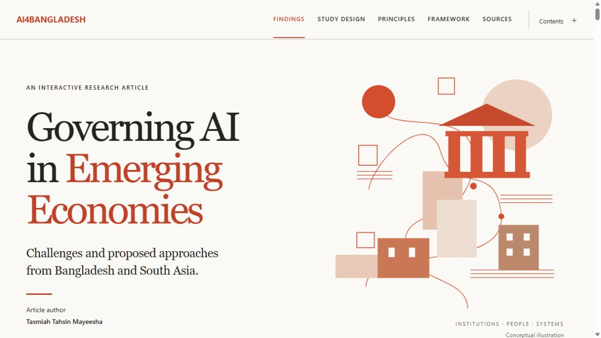

# Governing AI in Emerging Economies

*Challenges and proposed approaches from Bangladesh and South Asia.*

Article author: **Tasmiah Tahsin Mayeesha**

## Read the article

https://tahsin-mayeesha.github.io/governing-ai-emerging-economies/

## About

An interactive research article centered on **AI4Bangladesh**, with supporting work on explainability, generative AI regulation, and accountability, alongside the SIPG project report. It pairs key findings with suggested responses, original research figures, selected published quotations, and citations.

The source reader includes all **75 PDF pages** from the five publications. The article retains publication-specific methods and sample counts and distinguishes empirical findings from proposed frameworks and interventions.

## Research publications

- [AI4Bangladesh: AI Ethics for Bangladesh — Challenges, Risks, Principles, and Suggestions](https://doi.org/10.1145/3700794.3700820)
- [Know Your Users: Towards Explainable AI in Bangladesh](https://doi.org/10.1145/3675094.3679002)
- [Navigating the Unknown: Regulation of Generative AI in South Asia](https://doi.org/10.1093/9780198945253.003.0055)
- [Building Bridges: A Participatory Framework for AI Accountability in South Asia](https://doi.org/10.1145/3772363.3799093)
- [SIPG Working Paper, Series No. 15](https://northsouth.edu/sipg/working-papers.html)

Full citations, original PDFs, and bibliography pages are available inside the article.

## Technology

Static HTML, CSS, and JavaScript. No packages, API keys, database, or build step are required for GitHub Pages. Searches and interactions run in the browser.

For local preview, serve this directory using any static HTTP server. Opening `index.html` directly may prevent the browser from loading the JSON source library.

## Source attribution

Research figures and quotations retain their original attribution and reuse terms. Consult the original publications for copyright notices and third-party credits. The opening illustration and article layout are editorial design elements, not research data.

## Project credits

Original project: **Designing Accountable and Ethical AI for the Next Billions: Considering the Needs of South Asian Marginalized Communities**

Project team: **Tasmiah Tahsin Mayeesha, Farzana Islam, and Shahbaz Ahmed**

Research lab: [NSUHCI–DIAL, North South University](https://sites.google.com/view/nsuhci/home)

Research supervision: **Nova Ahmed**
